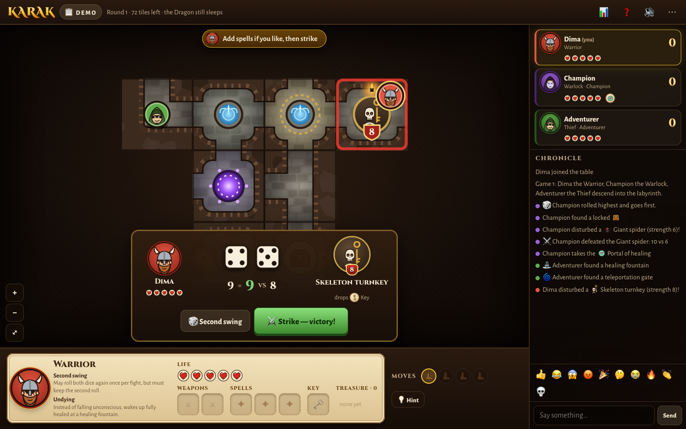

# Karak — online

Play Karak, the labyrinth-crawling board game, with friends in the browser. One person runs a small Python
server, everyone else just opens a link. Explore the dungeon tile by tile, fight monsters for their loot, open
treasure chests and slay the Dragon; bots can fill empty seats.



## Features

- **The full game**: 79 labyrinth tiles (corridors, rooms, healing fountains, teleport gates), 53 tokens
  (monsters and locked chests), two-dice combat, weapons, magic bolts, portals of healing, keys, the Curse,
  falling unconscious, and the Dragon with its ruby that ends the game.
- **Six heroes, each with two skills**: Warrior, Thief, Wizard, Warlock, Swordsman and Oracle.
- **A dungeon that looks the part**: stone tiles with torch-lit rooms, round monster tokens with strength
  shields, a parchment hero sheet with life hearts and inventory slots, and rolling dice.
- **1–5 players**: any mix of humans and bots, with three bot levels.
- **Multiplayer in the browser**: invite friends over your Wi-Fi or with a public link. Players can reconnect,
  move their seat to another device, or hand it to a bot if they drop out.
- **Table extras**: chat and emoji reactions, synthesised sounds, hints, an optional turn timer, keyboard controls.
- **Fair play**: the server holds the game state and checks every move. The bag order stays hidden, and only
  the Oracle sees the tokens she is choosing between.

## Requirements

- [uv](https://docs.astral.sh/uv/getting-started/installation/). It installs Python 3.12 and all
  dependencies for you.
- Optional: [cloudflared](https://developers.cloudflare.com/cloudflare-one/connections/connect-networks/downloads/),
  to invite friends from outside your network (`brew install cloudflared` on macOS).

## Quick start

```bash
uv run karak serve
```

Open <http://localhost:8000>, click **Create a table**, pick your hero, add bots or send the invite link to
friends, and click **Start game**.

| Command | Who can join |
| --- | --- |
| `uv run karak serve` | People on the same Wi-Fi/LAN, through the network link printed at startup |
| `uv run karak serve --tunnel` | Anyone, through a temporary public `trycloudflare.com` link |
| `uv run karak serve --public-url https://…` | Anyone, if you host the server behind your own domain or reverse proxy |

## How to play

On your turn you have **4 moves**. Click a glowing tile next to your hero (or use the arrow keys / WASD):

- **A `?` spot** explores: a new tile is drawn. If it fits in more than one way, turn it with ⟲ ⟳ and
  confirm with ✓. A new room gets a token from the bag — a monster or a locked chest.
- **A red spot** has a monster on it: walking in starts a fight. Roll two dice, add your weapons and any magic
  bolts, and beat the monster's strength to win its loot. A tie sends you back; a loss also costs a life.
- **A chest** opens with a key and holds a treasure. Unclaimed loot stays on the floor for anyone to pick up.
- End your turn on a **healing fountain** (the entrance is one) to heal fully and lift the Curse.

The game ends when someone slays the Dragon; the most treasure wins (the Dragon's ruby counts 1½).
The **?** button in the top bar has the full rules, the bestiary and every hero skill.

**Keyboard:** arrows/WASD move, `Space`/`Enter` roll and strike (and confirm a tile), `E` ends the turn,
`H` asks for a hint, `+`/`−`/`0` zoom.

**House rule:** if the labyrinth can't grow any further while the Dragon is still in the bag, it wakes up in
the empty room farthest from the entrance, so every game has an ending.

## Bots

| Bot | Strength | Plays like |
| --- | --- | --- |
| Squire | ★ | only takes sure fights, wanders a bit |
| Adventurer | ★★★ | takes fair odds, a little reckless with the Dragon |
| Champion | ★★★★★ | weighs every fight's odds and value, plans routes, curses the leader |
| AI | ★★★★★ | a neural network trained against the Champion; clearly stronger than it |

Compare bots head to head (seats rotate, heroes are random, games run in parallel):

```bash
uv run karak eval -a champion,adventurer,squire -n 300
```

### The AI bot

Every `*.npz` in `src/karak/bots/models/` appears in the lobby as a bot. The shipped `ai.npz` was trained in
three stages, each starting from the previous one (configs in `configs/`):

1. **Imitation** (`bc.yaml`, `bc_finetune.yaml`): learn to predict the Champion's move.
2. **PPO against Champions** (`ppo_champion.yaml`, then a second run on the same settings as `selfplay.yaml`
   with only Champions as opponents): learn from winning and losing.
3. **Self-play** (`selfplay.yaml`): mixes in the learner itself and frozen earlier copies. At this budget it
   matched the champions-only run head to head but scored lower against Champions, so it isn't shipped.

Every training game draws a random table size (2–5), random heroes and a random seat for the learner.
Win × n against Champions (500 games per size, 300 for imitation; 1.0 is a fair share):

| Players | 2 | 3 | 4 | 5 |
| --- | --- | --- | --- | --- |
| Imitation | 0.91 | 0.80 | 0.96 | 0.63 |
| PPO, 6M steps | 1.20 | 1.41 | 1.57 | 1.79 |
| PPO, +8M steps (`ai.npz`) | 1.29 | 1.76 | 1.94 | 2.21 |

The network sees the whole dungeon on a 24×24 grid centred on the explored area: 37 planes of tiles, exits,
monsters, fight odds, chests, items, hero positions and walking distances. Next to the grid is a vector with
every hero's sheet, seen from the network's own seat. Movement is chosen as a destination cell, and the engine
walks there along the shortest path. The network is a residual CNN with global-pooling blocks, and its policy
head scores every board cell plus a fixed list of the other actions. Playing needs only numpy (about 4 ms per
move); training needs the `train` dependency group (PyTorch, on Apple GPUs via MPS).

```bash
uv run karak train -c configs/bc.yaml                                   # writes runs/<time>_<name>/
uv run karak train -c configs/ppo_champion.yaml -s init=runs/<bc run>/policy_best.npz
uv run karak eval-ai runs/<run>/policy_best.npz -n 500                  # win × n per table size
uv run karak eval-ai A.npz --opponent ai:B.npz -n 300                   # one network against another
```

## Development

```bash
uv sync                                                    # install runtime + dev dependencies
uv run pytest                                              # rules, hero skills, bots, room protocol, hidden info
uv run ruff check --fix src tests scripts && uv run ruff format src tests scripts
```

The browser checks drive Google Chrome through Playwright (default macOS path, set by `CHROME` in
`scripts/shot.py` and `scripts/ui_check.py`):

```bash
uv run python scripts/demo.py --stage play --out shots/game.png   # screenshot a seeded table (home|lobby|play|combat|over)
uv run python scripts/ui_check.py                                 # click through a whole game; fails on any JS error
```

### Project layout

```
src/karak/
  game/      pure rules engine (no I/O): tiles, tokens, items, heroes, actions, the Game state machine
  bots/      Bot interface, the planner, the Squire / Adventurer / Champion bots, the AI bot and models/
  nn/        board encoding for the network and a numpy forward pass (no torch needed to play)
  rl/        training: environments, worker processes, the network, imitation + PPO loop, configs
  web/       room logic, FastAPI + WebSocket server, and the vanilla JS client in static/ (no build step)
  runner.py  play a bot-only game
  cli.py     the `karak` command (serve, eval, train, eval-ai)
configs/     training configs
scripts/     screenshots, browser checks, bot tuning, AI diagnostics
tests/       pytest suite
```

Dependencies only point downwards: `game` imports nothing from the project, `bots` imports `game`, and `web`
imports both. Conventions and invariants are in [`.cursor/rules/`](.cursor/rules/).

## License and credits

The code is released under the [MIT License](LICENSE). All artwork is original SVG drawn in code, and the sound
effects are synthesised in the browser.

This is an unofficial fan project for private games with friends. It is not affiliated with or endorsed by
the publisher or the designers of *Karak*. Heroes are named by their class and the rules are explained in our
own words. If you enjoy it, please buy the real board game.
